# Спецификация: Месячный бюджет

Текущая версия: **v12** (31.10.2026). Документ описывает, как приложение работает сейчас. Почему сделано именно так — в [DECISIONS.md](DECISIONS.md), как выглядит — в [DESIGN.md](DESIGN.md), что менялось — в [CHANGELOG.md](CHANGELOG.md).

Скриншоты в `screens/` делает `docs/shoot.py` из кода на примерах данных, на дату пн 26.10.2026.

---

## 1. Что это

Личное приложение для учёта расходов на месяц. Один пользователь, один телефон (iPhone), всё на русском, валюта только рубли.

Главное в приложении — экран месяца: общий бюджет и бюджеты по категориям, и быстрый ввод трат.

- **Платформа:** PWA, открывается с экрана «Домой» на iPhone, работает офлайн. Хостинг — GitHub Pages из этого репозитория.
- **Данные:** только на устройстве, в `localStorage`. Сервера и аккаунтов нет. Резервная копия — JSON-файл через настройки.
- **Тема:** только светлая.
- **Целевой экран:** iPhone 17 (402 × 874 pt). Главный экран помещается без прокрутки при 11 категориях.

---

## 2. Данные и расчёты

### 2.1. Модель

`localStorage`, ключ `monthly-budget-v1`:

```json
{
  "v": 1,
  "budget": { "2026-10": 150000 },
  "categories": [{
    "id": "…", "name": "Продукты", "icon": "shopping-cart",
    "type": "even",
    "created": "2026-10",
    "limits": { "2026-10": 30000 }
  }],
  "tx": [{
    "id": "…", "cat": "<id категории>", "amount": 1200, "date": "2026-10-22",
    "comment": "Магнит", "tags": ["<id тега>"], "demo": true
  }],
  "tags": [{ "id": "…", "name": "Отпуск на море" }],
  "settings": { "pace": false }
}
```

| Поле | Правило |
|---|---|
| `budget`, `limits` | Значение действует с указанного месяца и дальше, пока не задано новое. Поиск: самый поздний ключ `≤` открытого месяца. `null` — не задано. При изменении в месяце M ключи позже M удаляются, ставится значение на M. Прошлые месяцы не меняются |
| `type` | `even` — тратится равномерно; `oneoff` — разовый платёж (ЖКУ, подписки) |
| `created` | Месяц создания категории. В более ранних месяцах она не показывается, если в них нет её трат |
| `amount` | Целые рубли (старые траты могут быть с копейками, они показываются и правятся как есть) |
| `date` | `YYYY-MM-DD`, локальная дата |
| `tags` | Массив id тегов. Порядок тегов задаёт массив `S.tags` |
| `demo` | Пример трат при первом запуске. Убираются кнопкой «Убрать примеры». При правке траты флаг снимается |

Миграции схемы делаются в `load()` и при импорте: отсутствующие поля заполняются по умолчанию (например, `tags: []`). Схему нельзя менять несовместимо: у пользователя реальные данные.

### 2.2. Месяц

Календарный. Остатки и перерасход на следующий месяц не переносятся. Открыть месяц позже текущего нельзя.

### 2.3. Цвет состояния категории

Красится только по состоянию. У категорий нет своих цветов.

| Состояние | Цвет | Когда |
|---|---|---|
| `idle` | серый `#8C928E` | трат в месяце нет |
| `ok` | зелёный `#2F9A5B` | траты есть, темп в норме; у категорий без лимита — всегда, если есть траты |
| `warn` | жёлтый `#D08A0C` | темп от 100 до 120 % (только при включённой подсветке темпа) |
| `over` | красный `#D2382A` | темп больше 120 % или перерасход лимита |

**Темп** = потрачено / ожидаемое. Ожидаемое = лимит × (сегодняшний день / дней в месяце), но не меньше 12 % лимита: буфер, чтобы одна покупка в начале месяца не красила всё в красный. Для прошлых месяцев доля месяца равна 1.

- Подсветка темпа выключена (`settings.pace = false`): серый, зелёный, красный только при перерасходе.
- Разовые категории (`oneoff`) красятся красным только при перерасходе.
- Категории без лимита никогда не бывают красными или жёлтыми.

Цвет применяется к иконке и полоске на плитке.

---

## 3. Главный экран

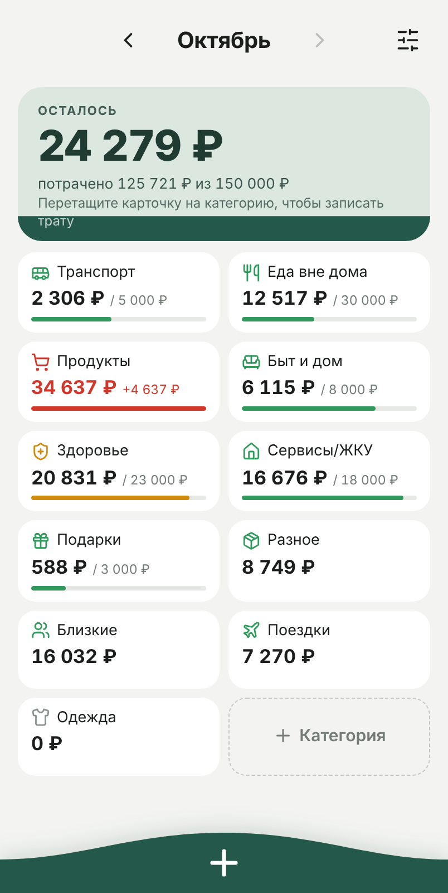 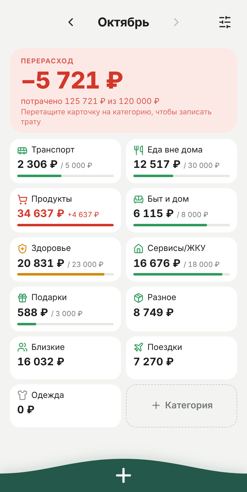 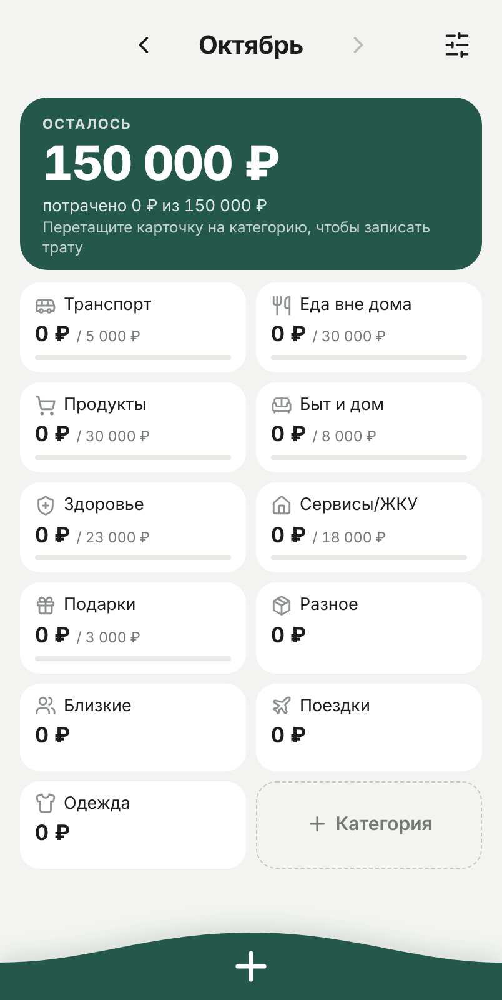

Слева направо: обычный месяц; перерасход общего бюджета; начало месяца без трат.

Экран фиксированной высоты, сам не прокручивается. Сверху вниз: шапка → (баннер примеров) → карточка бюджета → сетка категорий → нижняя панель.

### 3.1. Шапка

- Название месяца по центру, стрелки ‹ › вплотную к нему. Год показывается, только если он не текущий. Стрелка › неактивна в текущем месяце.
- Справа кнопка настроек.
- Свайпа между месяцами нет.
- В PWA шапка опущена на 14 px ниже safe area, подальше от системного размытия под Dynamic Island.
- На время тоста название месяца со стрелками скрыто, на его месте тост (см. 5.2).

### 3.2. Баннер примеров

При первом запуске создаются категории и примеры трат (`demo: true`). Жёлтая плашка: «Сейчас показаны примеры трат, чтобы было видно, как всё работает. **Убрать примеры**». Нажатие удаляет все траты с `demo`, категории остаются.

### 3.3. Карточка бюджета — «уровень»

Высота 138 px. Это источник перетаскивания и кнопка ввода траты.

- **Заливка.** Тёмно-зелёный слой снизу показывает долю остатка: `остаток / бюджет`. В начале месяца без трат вся карточка тёмная, по мере трат уровень опускается. Над уровнем светлый фон.
- **Двухцветный текст.** Карточка состоит из двух одинаковых слоёв: светлого с тёмным текстом и тёмного с белым. Тёмный слой обрезан `clip-path` по уровню, поэтому текст меняет цвет там, где его пересекает граница.
- **Содержимое:** «ОСТАЛОСЬ», крупно остаток, строка «потрачено 125 721 ₽ из 150 000 ₽», подсказка «Перетащите карточку на категорию, чтобы записать трату».
- **Перерасход:** карточка розовая без заливки, «ПЕРЕРАСХОД», красное «−5 721 ₽».
- **Бюджет не задан:** светлая карточка, «ПОТРАЧЕНО», сумма трат, «Бюджет на месяц не задан».
- Цвет состояния (раздел 2.3) к карточке не применяется.
- Короткое нажатие открывает ввод траты без выбранной категории.
- Перетаскивание открывает ввод с выбранной категорией (3.5).

### 3.4. Плитки категорий

Сетка 2 столбца, зазор 8 px. Плитка: иконка в цвете состояния и название; сумма трат и «/ лимит»; полоска заполнения.

- **Перерасход:** сумма красная, вместо «/ лимит» красное «+4 637 ₽», полоска красная на всю ширину.
- **Без лимита:** только сумма, без подписи и без полоски.
- **Полоска:** ширина = потрачено / лимит, минимум 3 %, если траты есть.
- Последняя плитка — «+ Категория» с пунктирной рамкой, открывает создание категории.
- Нажатие на плитку открывает историю трат категории (раздел 7).
- Если плитки не помещаются, прокручивается только сетка, шапка и панель стоят на месте. У сетки внутренний запас 10 px со всех сторон (компенсирован отрицательным отступом), чтобы пульс и рамка анимации не обрезались.

### 3.5. Перетаскивание карточки

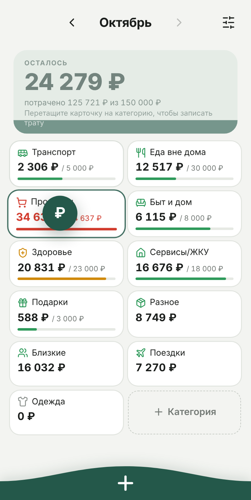 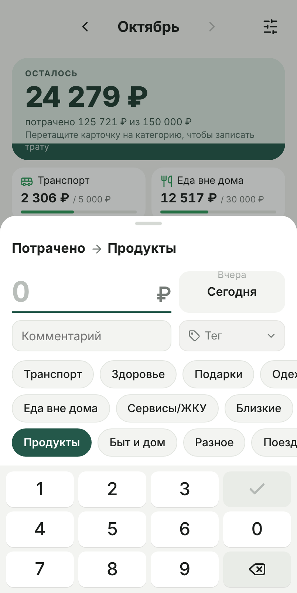

Зажать карточку (250 мс) или сразу потянуть дальше 6 px. Карточка уменьшается и бледнеет, за пальцем идёт зелёный кружок «₽». Плитка под пальцем подсвечивается зелёной рамкой и увеличивается. Отпустить над плиткой — открывается ввод траты с этой категорией. Отпустить мимо — ничего.

### 3.6. Нижняя панель

Тёмно-зелёная, во всю ширину, высота 56 px плюс safe area. По краям 30 px, к центру плавный подъём, на вершине белый «+». Нажатие в любом месте панели открывает ввод траты.

---

## 4. Ввод траты

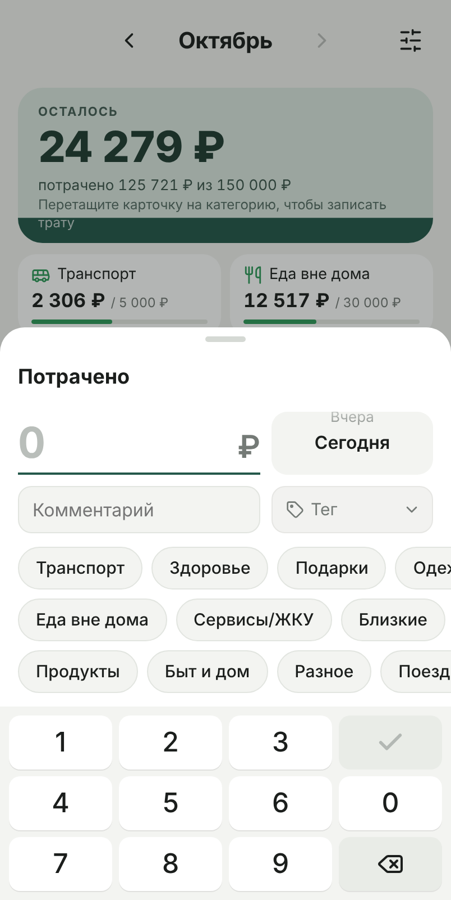 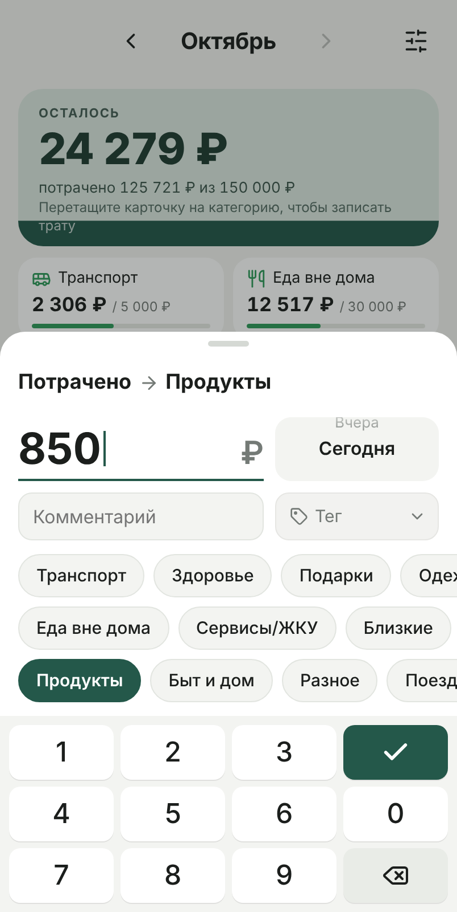 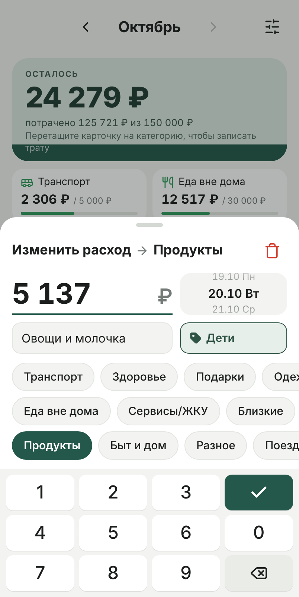

Нижняя шторка. Открывается тремя способами:
- нажатие на карточку бюджета или на нижнюю панель — категория не выбрана;
- перетаскивание карточки на плитку — категория выбрана;
- «Добавить трату» в истории категории — категория выбрана.

Сверху вниз: полоска → заголовок → сумма и дата → комментарий и тег → категории → клавиатура.

### 4.1. Заголовок

«Потрачено», а после выбора категории — «Потрачено → Продукты». Текст без иконки. При правке сохранённой траты — «Изменить расход → …», справа красная корзина.

### 4.2. Сумма

Крупно (38 px), подчёркнута зелёной линией, справа «₽», мигающий курсор. Пустая сумма — бледный «0» на той же линии. Ввод только со своей клавиатуры, системная не появляется.

### 4.3. Клавиатура

```
1  2  3  ✓
4  5  6  0
7  8  9  ⌫
```

- Клавиши 48 px высотой, во всю ширину, срабатывают на нажатие (`pointerdown`).
- До 7 цифр, только целые рубли. Ведущий ноль заменяется цифрой.
- Удержание ⌫ дольше 550 мс стирает сумму целиком.
- **✓** записывает трату. Серая и неактивная, пока нет суммы больше 0 или не выбрана категория, зелёная, когда готово. Отдельной кнопки «Записать» нет.
- На компьютере работают цифры, Backspace и Enter (= ✓).

### 4.4. Дата — барабан

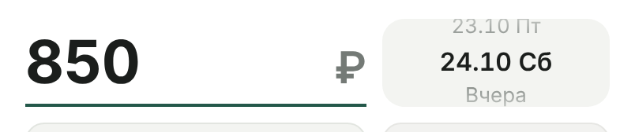

Кнопка 144 × 56 px справа от суммы. Внутри маленький барабан: выбранная дата крупно по центру, сверху и снизу бледные краешки соседних дат.

- **Порядок:** вверху ранние даты, внизу сегодня. Тянешь вниз — листаешь назад. Доводка до ближайшей даты (`scroll-snap`).
- **Диапазон:** 5 последних дней прошлого месяца, затем от 1-го числа до сегодня. Для прошлого месяца, открытого стрелкой, — до последнего дня этого месяца. Будущих дат нет.
- **Подписи:** «Сегодня», «Вчера», дальше «22.10 Чт» (дни недели: Пн Вт Ср Чт Пт Сб Вс).
- Нажатие на краешек выбирает эту дату.
- **По умолчанию:** сегодня, а в прошлом месяце — его последний день. При правке — дата траты.

### 4.5. Комментарий

Поле во всю оставшуюся ширину, высота 42 px, подсказка «Комментарий». Необязательное. Пока поле в фокусе, наша клавиатура скрыта и видна системная. Enter убирает фокус.

### 4.6. Тег

Кнопка 144 × 42 px справа от комментария. Подробно — раздел 6.

### 4.7. Категории — чипсы

Плоские чипсы без цветов и иконок, 38 px высотой, разложены в 1–3 ряда (до 4 категорий — 1 ряд, до 8 — 2, больше — 3). Ряды прокручиваются вбок вместе, от края до края экрана. Порядок как на главной, по рядам раскладываются так, чтобы ряды были примерно одной длины.

- Нажатие выбирает категорию: чипс становится тёмно-зелёным с белым текстом, категория появляется в заголовке. Трата при этом не сохраняется.
- Выбранный чипс прокручивается в видимую часть так, чтобы быть виден целиком с отступом 16 px. То же при открытии с уже выбранной категорией.

### 4.8. Правка и удаление

- В истории категории нажатие на трату открывает ту же шторку с заполненными полями.
- ✓ сохраняет и возвращает на главную с анимацией из раздела 5.
- Корзина в заголовке удаляет трату: первое нажатие делает её красной и показывает тост «Нажмите ещё раз, чтобы удалить», второе удаляет. После удаления тост «Трата удалена» и возврат в историю категории.

### 4.9. Закрытие без сохранения

Свайп вниз за полоску или заголовок (больше 90 px, или больше 30 px быстрым движением), нажатие на затемнение, Esc. Крестика нет.

---

## 5. Сохранение: анимация и тост

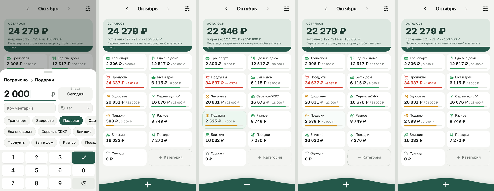

Кадры слева направо: нажатие ✓ → шторка ушла → цифры докручиваются, плитка вспыхивает → итог.

### 5.1. Последовательность

| Время | Что происходит | Параметры |
|---|---|---|
| 0 мс | Трата сразу записывается в хранилище. Экран нарочно отстаёт от данных | — |
| 0 мс | Клавиша ✓ пружинит, галочка дорисовывается | scale 1 → 0.86 → 1.07 → 1, 260 мс; обводка 220 мс |
| 170 мс | Шторка уезжает вниз, затемнение гаснет | 340 мс `cubic-bezier(.32,.72,0,1)`; затемнение 290 мс ease-out |
| ~375 мс | Тост, если он нужен (5.2) | — |
| 510 мс | Перерисовка главной и одновременно: | — |
| | сумма категории докручивается | 520 мс, кубический ease-out |
| | «Осталось» докручивается, уровень заливки опускается; строка «потрачено…» меняется сразу | 520 мс |
| | полоска дорастает | 650 мс `cubic-bezier(.3,.7,.3,1)` |
| | плитка пульсирует | scale 1 → 1.06 → 1, 460 мс |
| | фон плитки вспыхивает | белый → `#DDF0E4` + рамка 2 px `rgba(47,138,87,.45)` на 25 % времени → белый, 1100 мс |
| ~1,6 с | Всё закончено | — |

**Правила**
- **Ничего не блокируется.** Новая трата во время анимации сразу ставит прошлые прокрутки в итоговое значение (`stopAnims()` в начале `render()`).
- **Выход за лимит этой тратой:** красный цвет и «+N ₽» появляются в конце прокрутки, до этого плитка в прежнем цвете с «/ лимит».
- **Если карточка бюджета при этой трате переходит в перерасход,** её цифры не анимируются, она сразу показывает итог.
- **Дата вне открытого месяца:** главная не анимируется, только тост.
- **Системное «Уменьшить движение»:** шторка исчезает затуханием 200 мс, цифры и полоска меняются сразу, пульса и пружины нет. Остаётся только вспышка фона плитки.
- **Вибрации нет:** iOS не даёт её веб-приложениям, см. DECISIONS.

### 5.2. Тост

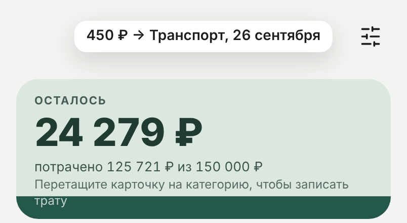

Светлая плашка на месте названия месяца: белый фон, тень, 14 px полужирный, отступы 6 × 12, скругление 12. Пока тост виден, «‹ Октябрь ›» скрыт. Держится 3,6 с.
- Появление: 280 мс, сверху вниз на 14 px, scale 0.96 → 1.
- Уход: 220 мс, вверх на 6 px.
- Новый тост во время показа меняет текст и перезапускает отсчёт.

**После сохранения траты** тост появляется только тогда, когда изменения не видно на экране:
- дата траты вне открытого месяца;
- плитка категории пролистана за край сетки (видно меньше половины её высоты). Плитка всё равно анимируется, к ней не прокручиваем.

Текст: «125 ₽ → Здоровье, сегодня» / «вчера» / «28 сентября» / «28 декабря 2025» (год, если не текущий).

Остальные уведомления используют тот же тост: «Трата удалена», «Бюджет сохранён», «Категория создана», «Тег удалён», ошибки ввода и т. п.

Кнопки «Отменить» в тосте нет: ошибочную трату удаляют через историю.

---

## 6. Теги

Тег отвечает на вопрос «в рамках чего» потрачено, категория — «на что». Например, «Отпуск на море» объединяет Транспорт, Еду вне дома и Подарки одной поездки. Теги общие для всех категорий, на трате их может быть сколько угодно.

- До **15** тегов, название **1–14** символов.
- Название хранится без пробелов по краям, несколько пробелов подряд схлопываются в один.
- **Ключ сравнения:** без учёта регистра, пробелов по краям и «ё» = «е». «ДЕТИ», « дети » и «Дети» — один тег, «Ёлка» и «Елка» тоже.
- Теги показываются только в форме ввода и на странице тегов. В истории трат и аналитике их пока нет.

### 6.1. Кнопка тега

| Состояние | Вид |
|---|---|
| Нет тегов | Фон `#F2F2F0`, рамка `#E6E6E3`, контурная серая иконка, «Тег», шеврон вниз |
| Один тег | Фон `#E7EFEA`, рамка `#2F5446`, залитая тёмно-зелёная иконка, название. Шеврона нет |
| Несколько | Как «один» + бейдж «+N». Показан первый тег по порядку из настроек, а не по времени выбора |
| Длинное название | Обрезается многоточием, бейдж не обрезается никогда |

Для скринридера кнопка называется «Выбрать тег» или «Теги: Отпуск на море, Дети». Нажатие открывает меню, повторное закрывает.

### 6.2. Меню тегов

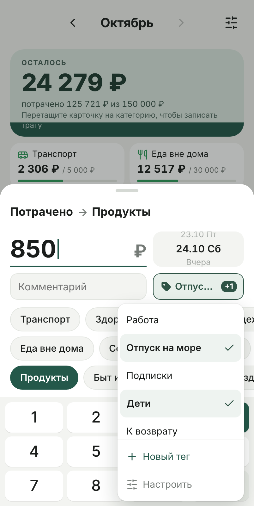 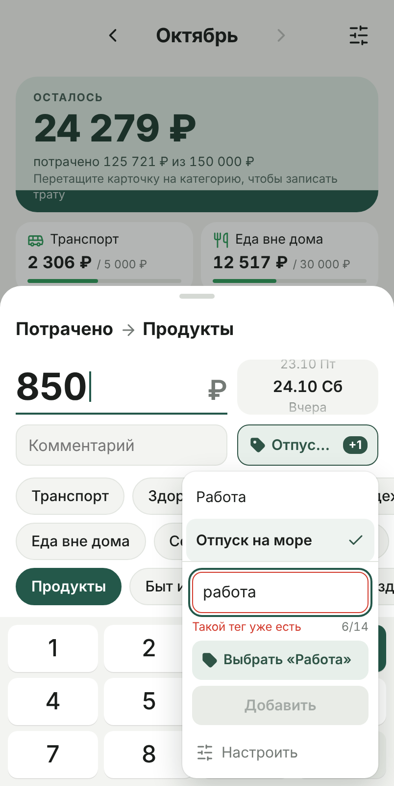 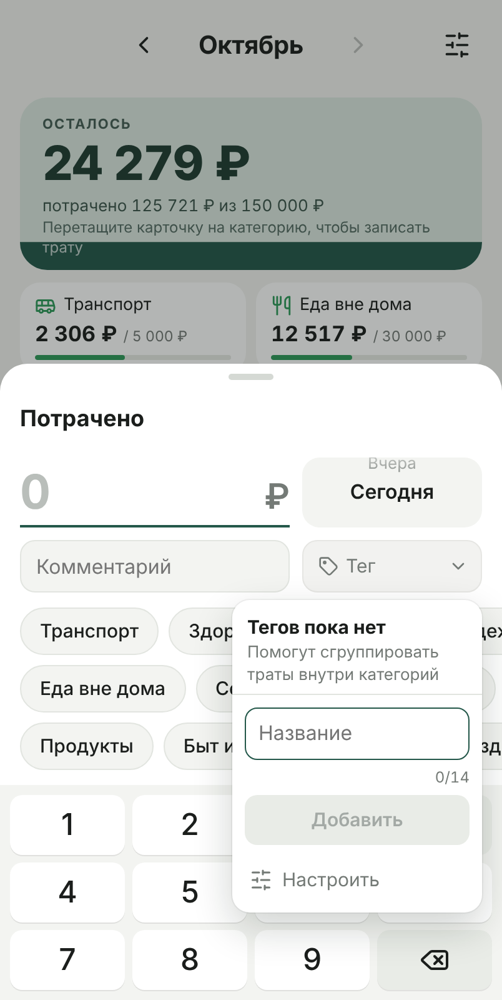 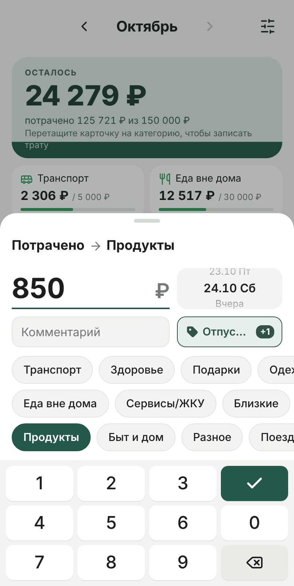

Выпадает под кнопкой, ширина 200 px, правый край по кнопке. Позиция `fixed`, считается от кнопки. Если места снизу меньше 220 px и сверху больше, меню открывается вверх.

- **Список:** теги в порядке из настроек, строки от 44 px, шрифт 15 px. Выбранный тег — галочка справа, полужирный, фон `#EEF3F0`. Повторное нажатие снимает выбор. Длинные названия не обрезаются, а переносятся. Высота списка до 236 px, дальше он прокручивается внутри меню, не прокручивая форму.
- **Под списком, через разделитель:** «+ Новый тег» (зелёный) и «Настроить» (серый, иконка настроек).
- **Лимит 15:** «Новый тег» неактивен, под ним «Максимум 15 тегов». «Настроить» остаётся активным.
- **Пустое состояние:** «Тегов пока нет» и «Помогут сгруппировать траты внутри категорий», сразу поле создания.
- Меню не закрывается между выборами.
- **Закрытие:** повторное нажатие на кнопку; нажатие в любом месте вне меню, и это же нажатие выполняет своё действие (цифра вводится, категория выбирается); сохранение или закрытие формы; Esc.

### 6.3. Создание тега из меню

«Новый тег» заменяется полем «Название» со счётчиком «n/14» и кнопкой «Добавить». Поле получает фокус, появляется системная клавиатура.

| Ситуация | Видно | «Добавить» |
|---|---|---|
| Пусто или одни пробелы | ничего | неактивна |
| 14 символов | счётчик красный, дальше не вводится; вставка длиннее обрезается | активна |
| Совпадает с тегом, не отмеченным на трате | красная рамка, «Такой тег уже есть», плашка «Выбрать «Дети»» | неактивна |
| Совпадает с отмеченным | красная рамка, «Такой тег уже есть», без плашки | неактивна |
| Всё в порядке | зелёная рамка | активна |

- «Добавить» и «Готово» на клавиатуре создают тег в конце списка, сразу отмечают его на трате и закрывают поле. Меню остаётся открытым.
- Плашка «Выбрать «…»» отмечает существующий тег и закрывает поле.
- **Жизнь поля:**
  - поле пустое и отмечен тег — поле закрывается;
  - в поле есть текст и отмечен тег — поле остаётся;
  - меню закрыли с текстом — при следующем открытии поле с тем же текстом, тег при закрытии не создаётся;
  - форму закрыли или сохранили — текст теряется.
- Пока поле в фокусе, нажатия на строки меню не убирают фокус, и клавиатура остаётся.

### 6.4. Страница «Теги»

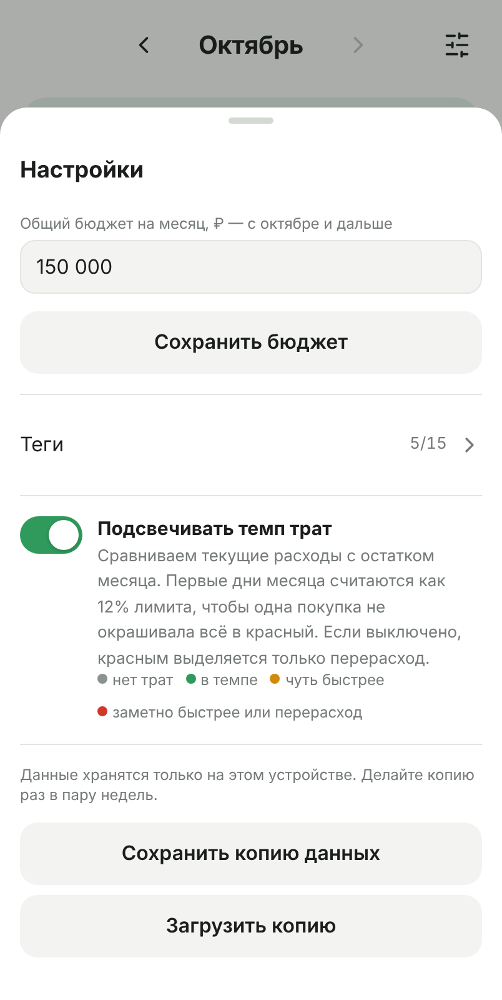 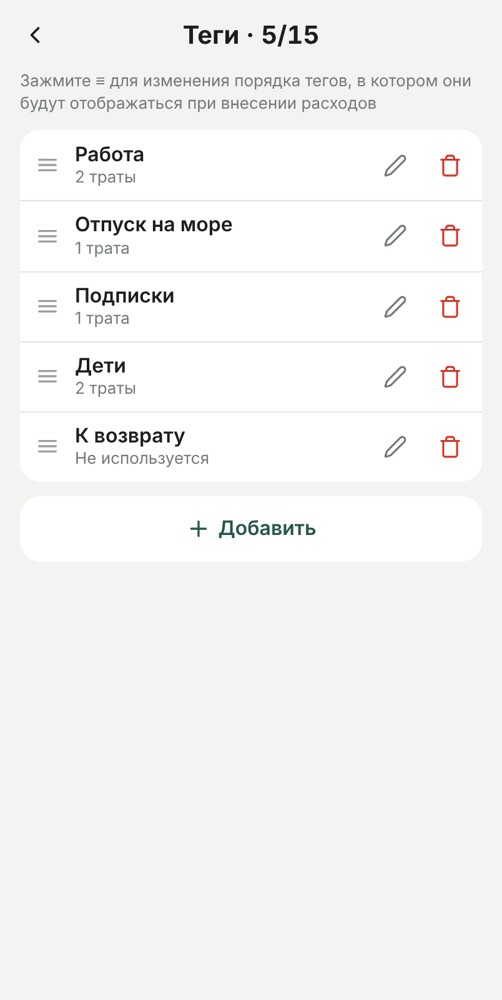 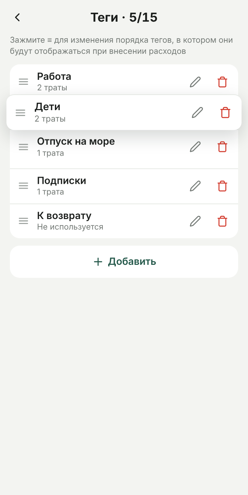

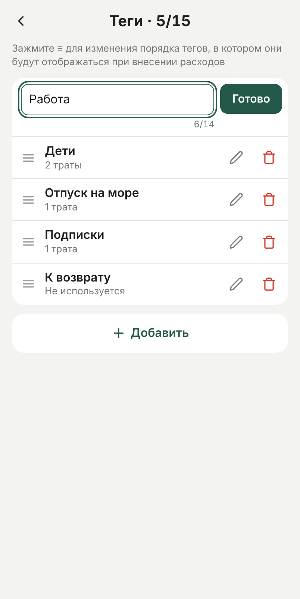 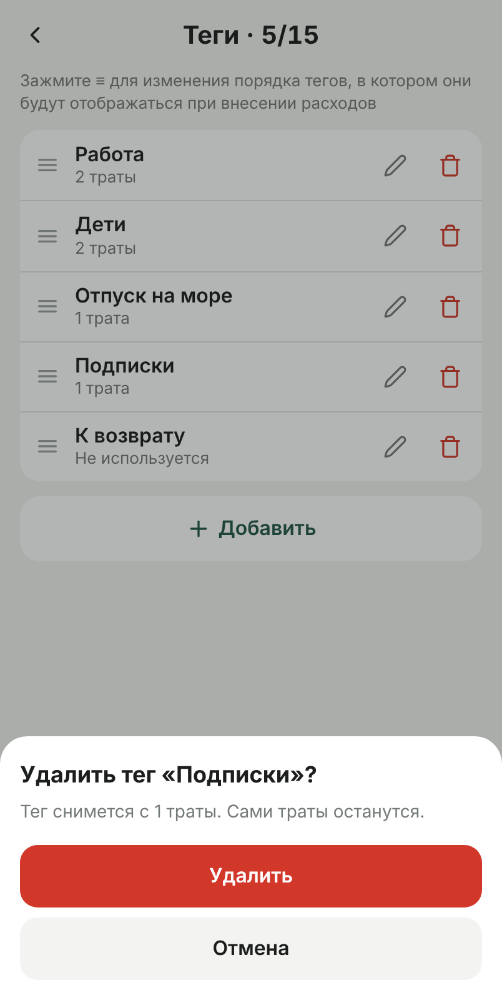

Полноэкранная страница, выезжает справа поверх всего. Открывается двумя путями:
- «Настройки → Теги» (строка «Теги · 5/15 ›»);
- «Настроить» в меню тегов. Тогда «назад» возвращает в форму со всем введённым и снова открывает меню, изменения тегов уже видны.

- **Шапка:** ‹ и «Теги · n/15», где n — сколько тегов сейчас, 15 — максимум. Под ней подсказка «Зажмите ≡ для изменения порядка тегов, в котором они будут отображаться при внесении расходов».
- **Строка (56 px):** ручка ≡; название (16 px, полужирное) и под ним число трат («23 траты», «Не используется»); карандаш; красная корзина. Нажимаемые области не меньше 44 × 44.
- **Порядок.** Тянешь за ≡: строка приподнимается (scale 1.03, тень) и идёт за пальцем, соседние строки сдвигаются на её высоту за 220 мс. Строку нельзя вытащить за пределы списка, порядок сохраняется при отпускании. Автопрокрутка: в зоне 60 px у верхнего и нижнего края видимой области список прокручивается тем быстрее, чем ближе к краю, до одной строки за 100 мс. Вне ручки свайп прокручивает страницу. С клавиатуры: фокус на ручке, ↑ и ↓ переставляют. Пока одна строка переименовывается, перетаскивание не начинается.
- **Переименование.** Нажатие на название или карандаш превращает строку в поле со счётчиком и «Готово». Проверки как при создании, но без плашки «Выбрать». Смена регистра у самого тега — не совпадение. Пустое название не сохраняется, остаётся прежнее. Новое название сразу видно во всех тратах.
- **Удаление.** Корзина всегда открывает подтверждение снизу: «Удалить тег «X»?», «Тег снимется с N трат(ы). Сами траты останутся.» или «Тег не используется ни в одной трате.»; кнопки «Удалить» (красная) и «Отмена». После удаления тост «Тег удалён». Тег снимается со всех трат.
- **Добавление.** «+ Добавить» под списком открывает карточку с полем «Название тега», счётчиком, «Отмена» и «Добавить». Проверки без плашки. При 15 тегах кнопка неактивна, под ней «Можно создать до 15 тегов. Удалите ненужный, чтобы добавить новый».
- **Нет тегов:** «Тегов пока нет».

### 6.5. Краевые случаи

| Случай | Поведение |
|---|---|
| В «Настроить» удалили тег, отмеченный в форме | после возврата тег снят с формы |
| Переименовали или переставили отмеченный | на кнопке и в меню новое название и порядок |
| Открыта правка траты с удалённым тегом | его нет: при удалении тег снимается со всех трат |
| Отмечены все 15 | кнопка: первый тег и «+14» |
| Удалили категорию вместе с тратами | теги остаются, их счётчики уменьшаются |

---

## 7. История трат категории

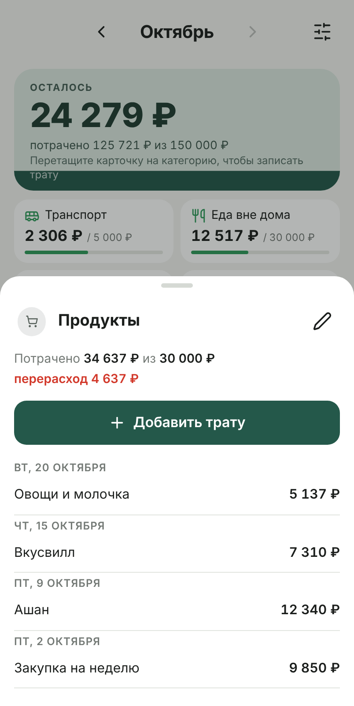

Шторка по нажатию на плитку.
- **Заголовок:** иконка, название, карандаш (настройка категории).
- **Сводка:** «Потрачено X из Y» и «осталось Z» или красное «перерасход Z». Без лимита — «без лимита».
- Кнопка «+ Добавить трату».
- Траты за открытый месяц по дням, новые сверху: заголовок дня «пн, 20 октября», строки «комментарий — сумма» («Без комментария» серым). Нажатие на строку открывает правку (4.8).
- Пусто: «В октябре трат нет».

## 8. Настройка категории

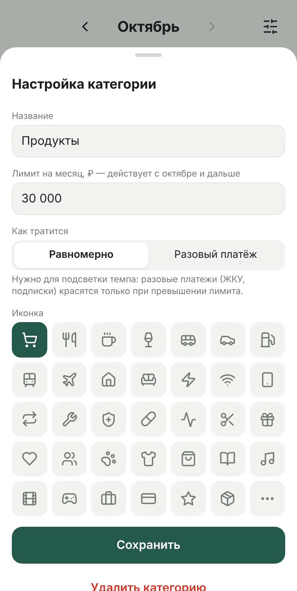

Шторка из карандаша в истории или из плитки «+ Категория».
- Название (до 24 символов).
- Лимит на месяц, действует с открытого месяца и дальше. Пусто — без лимита. Разряды разделяются при вводе.
- «Как тратится»: Равномерно / Разовый платёж, с пояснением.
- Иконка из набора Lucide.
- «Сохранить» или «Создать категорию».
- «Удалить категорию» с подтверждением вторым нажатием: «Удалить вместе с N тратами? Нажмите ещё раз».
- Новая категория создаётся в открытом месяце (`created`).

## 9. Настройки

Шторка по кнопке в шапке.
- **Общий бюджет на месяц**, с открытого месяца и дальше. Разряды разделяются при вводе (`150000 → 150 000`). Кнопка «Сохранить бюджет».
- Строка **«Теги · n/15 ›»** открывает страницу тегов.
- **«Подсвечивать темп трат»** — переключатель с пояснением: «Сравниваем текущие расходы с остатком месяца. Первые дни месяца считаются как 12% лимита, чтобы одна покупка не окрашивала всё в красный. Если выключено, красным выделяется только перерасход.» Легенда цветов: нет трат, в темпе, чуть быстрее, заметно быстрее или перерасход.
- **Резервная копия:** «Данные хранятся только на этом устройстве. Делайте копию раз в пару недель.»
  - «Сохранить копию данных» открывает системное меню «Поделиться» с файлом `budget-YYYY-MM-DD.json`. Если меню недоступно, показывается текст для копирования.
  - «Загрузить копию» заменяет все данные содержимым файла.

## 10. Окна и слои

- **Все шторки** выезжают снизу, скругление 22 px сверху, затемнение `rgba(20,24,22,.32)`. Закрываются свайпом вниз за полоску или заголовок, нажатием на затемнение или Esc. Крестиков нет.
- **Клавиатура iOS:** когда она открыта, шторка и страница тегов поднимаются над ней (по `visualViewport`).
- **Слои (z-index):** нижняя панель 5 · затемнение 20 · шторка 21 · меню тегов 30 · страница тегов 40 · подтверждение 50 · тост 60.

## 11. Известные ограничения iOS — проверять на устройстве

- Под статус-баром и Dynamic Island iOS 26 размывает верх страницы. Шапка опущена на 14 px, ниже опускать не стали.
- Подъём шторки над клавиатурой через `visualViewport` в браузере на компьютере не проверить.
- Инерцию барабана даты нужно смотреть пальцем.
- Данные PWA с экрана «Домой» отделены от данных во вкладке Safari.

## 12. Не входит / бэклог

- Теги в истории трат: прорабатывался вариант «теги серым слева от суммы, в одну строку». Аналитика и фильтры по тегам.
- Доходы, счета, цели (были на исходном скрине-референсе).
- Порядок категорий, тёмная тема, синхронизация между устройствами.
- Анимация «полёт суммы в категорию» (вариант 4 из PRD анимации).
